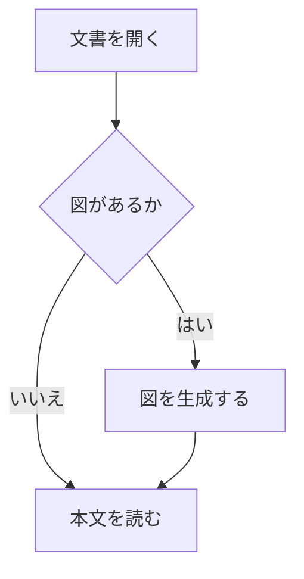
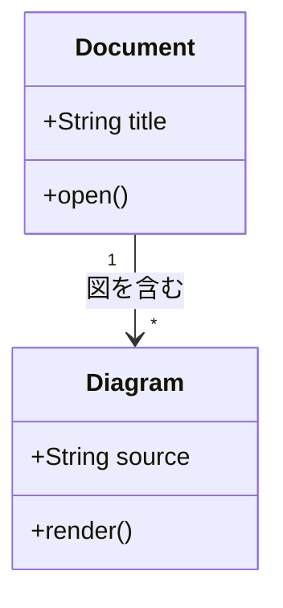
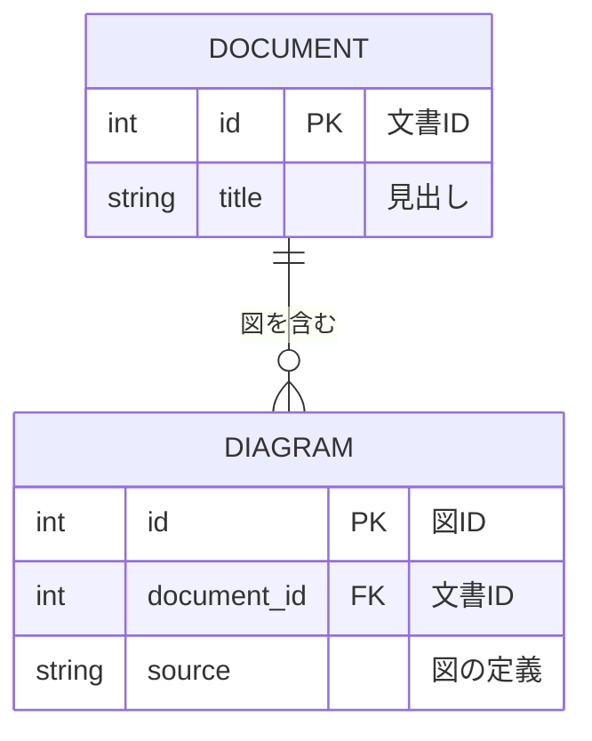

# Mermaid組み込みの検証

本文は図の生成を待たずに表示します。`/`で「検証本文」を検索できます。

## フローチャート



検証本文その1。生成中も検索やスクロールを試してください。

## クラス図



検証本文その2。ウィンドウ幅を変えて図の大きさを確認してください。

## ER図



検証本文その3。図の後にも本文を表示します。

通常のコードブロックは引き続きコードとして表示します。

```rust
fn main() {
    println!("Mermaidではないコード");
}
```
