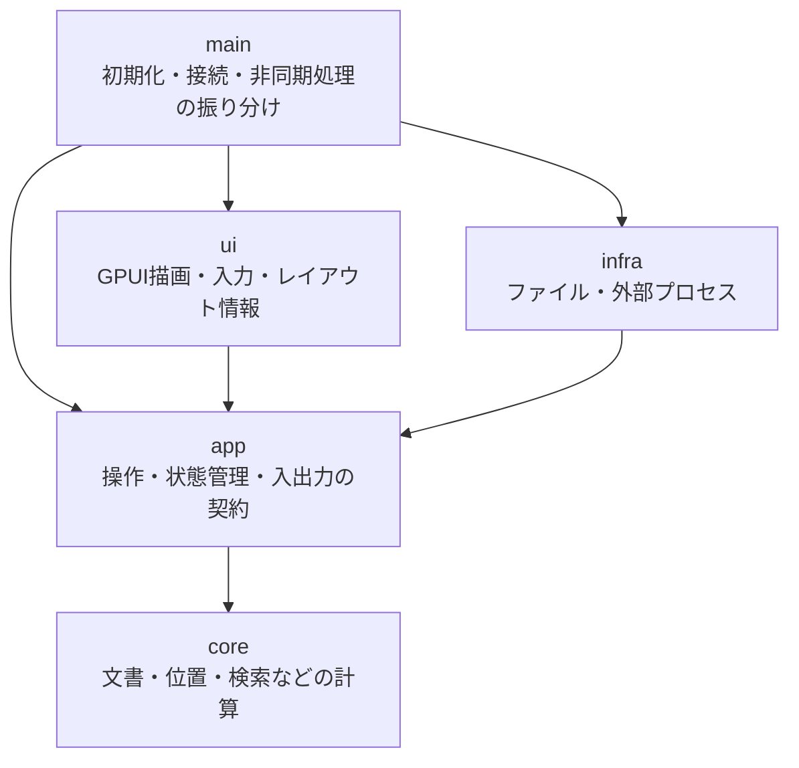

# GPUI採用前検証サンプル

## この資料の位置づけ

GPUIとgpui-componentを用いて、製品が必要とする描画・操作を実現できるか確認するためのサンプルの計画・設計です。製品の仕様書や、製品実装の詳細設計ではありません。

- 検証対象とモジュール構成、API境界の基本方針：会話で合意済み。
- 具体的なRustの型、GPUIの利用API、位置対応付けの実現方法：技術検証で具体化する段階。
- サンプル実装：V-01・V-02向けの初期実装にV-05（Mermaid）と、クリックによるローカルファイルの切り替えを追加。範囲と実行方法は[初期サンプルの実行](running.md)を参照。
- Normal / Search / Commandと下部2行のUI：実装済み。`:q`以外のコマンドは未対応。検索開始位置の制約と確認範囲は[モードUIの検証結果](results-modal-ui.md)を参照。
- 自動チェックとWindowsでのDebug起動・終了：実施済み。[初期実装の検証結果](results-initial.md)と[Mermaidの検証結果](results-mermaid.md)を参照。
- V-03・V-04、およびV-05の閲覧位置保持：今回の対応対象外。製品要件の削除は意味しない。
- Mermaidの図生成・実機表示：確認済み。基本描画全体の目視検証・Releaseでの起動時間計測：未実施。
- 初期実装の追加は、製品実装の開始や描画基盤の採用決定を意味しません。

サンプル固有の操作や省略は製品の要件に反映しません。検証で製品の要件を満たせないことが分かっても、要件を自動的に変更せず、代替案と影響を整理して相談します。

## 目的と前提

Windows上で小さなサンプルを動かし、公開資料だけでは判断できないAPIの制約、追加実装の必要性、描画結果、起動時間を確認します。

- Rustで作成し、まず1つのcrate内をモジュール分割する。
- 1つのサンプルに検証項目を順番に追加する。製品全体の骨組みを先に作り込まない。
- 描画基盤はGPUIとgpui-componentを候補とする。具体的な依存バージョンと組み合わせは、検証開始時に確認・記録する。
- 図の生成はmermaid-cliを使って検証する。利用者による関連ツールの事前インストールは許容されている。
- 製品ではなく、このサンプルに対する構成方針として扱う。製品への流用は検証結果を踏まえて判断する。

## 参照する製品の要件・調査

要件は参照元で管理し、このサンプルの資料へ丸ごと転記しません。

| 参照先 | 検証に関係する内容 |
|---|---|
| [要求・要件の全体像](../../../requirements/index.md) | Windows、読み取り専用、起動の速さ |
| [ファイル表示と更新](../../../requirements/features/file-viewing.md) | 再表示後の閲覧位置保持 |
| [Markdown描画](../../../requirements/features/markdown-rendering.md) | 日本語の本文、表、チェックリスト、コード、画像 |
| [スクロールと先頭・末尾への移動](../../../requirements/features/navigation.md) | 表示位置の操作 |
| [本文検索](../../../requirements/features/search.md) | 一致箇所の強調と位置への移動 |
| [リンクと履歴](../../../requirements/features/links-history.md) | Vimium風の文字ラベル選択に必要なリンク情報 |
| [Mermaid図](../../../requirements/features/mermaid.md) | 非同期の図生成と表示後の閲覧位置保持 |
| [技術方針と採用前の検証](../../../research/technology-assessment.md) | 資料調査で確認できたことと未検証の点 |

## 対象範囲

| 対象 | 確認すること |
|---|---|
| 基本描画 | 必要なMarkdown要素、ローカル画像・Web画像を描画できるか |
| 検索 | 表示テキストを取得し、一致範囲を強調して画面内へ移動できるか |
| リンク選択 | 表示中のリンクと位置を取得し、文字ラベルを重ねて選択できるか |
| 閲覧位置保持 | 前方への文章追加と再表示、図の後付け表示でも読んでいた箇所を保てるか |
| Mermaid | フローチャート、クラス図、ER図を非同期生成してMarkdown表示に組み込めるか |
| 起動時間 | WindowsのReleaseビルドで、起動から本文表示までを計測できるか |

次はサンプルの対象外です。製品の対象外を意味するものではありません。

- 正式なCLIコマンド体系、Named Pipe、単一起動制御。
- 完成版の検索UIと履歴管理。
- 永続キャッシュとログ管理の仕組み全体。
- ファイル監視機構全体。位置保持の検証では、再読み込みを起こせる手段で確認する。

## 構成と責務

矢印は「依存元 → 依存先」を示します。処理順序やデータの流れる方向ではありません。

| モジュール | 責務と境界 |
|---|---|
| `main` | 初期化と接続、I/O要求の実行開始、完了通知の配送を担当する。機能上の判断は持たない |
| `core` | 検索、位置の対応付け、ラベル割り当てなどを入力と出力で扱う。GPUI・ファイル・プロセスに依存しない |
| `app` | 操作・完了通知を受けて状態を更新し、I/O要求と表示要求を返す。具体的な描画・I/O実装に依存しない |
| `ui` | 状態の描画、入力の通知、表示テキスト・リンク位置・閲覧位置の取得、強調とスクロールを担当する |
| `infra` | ファイル読み込みとmermaid-cli実行を担当する。`app`が定義する要求・結果の契約を使用し、表示の採否を判断しない |

将来のキャッシュ判定は`core`、保存処理は`infra`に分離できるが、今回の検証のために完成版を実装しません。モジュール内のファイルは必要になった単位で分け、空のモジュールや不要な抽象化を先に作りません。

## 主要な処理の流れ

1. `ui`が操作やレイアウト情報を通知する。
2. `app`が通知を受け、必要な計算を`core`へ渡して状態を更新する。
3. `app`が表示要求とI/O要求を返す。現在の状態は読み取り用APIで取得する。
4. `main`が表示要求を`ui`へ渡し、I/O要求を`infra`で実行する。重い生成処理でUIを待たせない。
5. I/O完了・失敗を`app`へ通知する。現在の文書に適用できるかを`app`が判断する。

## 共通の設計方針と資料

- GPUIの型・ハンドルは`ui`側に閉じ込める。
- ソース位置、表示テキスト位置、画面座標を混同しない。
- 非同期処理の結果には対象を識別する情報を持たせ、古い文書・図の結果を現在の表示に適用しない。
- GPUIの都合を隠すためだけに独自のMarkdown解析器を作らない。
- 純粋な計算、状態更新、実際のI/O、GPUIとの連携を別々に検証する。すべてをモックに置き換えない。

詳細は[モジュール間のAPI契約](api-contracts.md)と[検証計画](verification.md)を参照してください。初期実装の範囲、試験条件、実行方法と次段階のAPI上の制約は[初期サンプルの実行](running.md)に記載しています。
